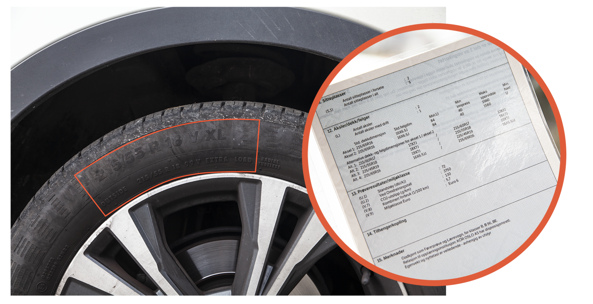

Q: What is the safety check in the Norwegian practical driving test?
A: The first part of the test. You are treated as the driver (not the examiner) and are responsible for the car being in proper condition.

---

Q: How many questions does the examiner usually ask in the safety check?
A: Usually one, but follow-up questions are possible.

---

Q: Which topic areas can the safety check cover?
A: Weights and cargo, brakes, tires, lights, steering, and other items (instruments and buttons, etc.).

---

Q: Where do you find the maximum towable trailer mass for your car?
A: In the vehicle registration certificate (vognkort), in the "Weights" section.

---

Q: Example registration certificate: what is the maximum braked trailer weight, and the maximum unbraked trailer weight?
A: Braked: 1300 kg. Unbraked: 687 kg.

---

C: In the example certificate, the permitted trailer weight is [1300 kg] with brakes and [687 kg] without brakes.

---

Q: Example registration certificate: what is the permitted roof load?
A: 75 kg.

---

Q: Example registration certificate: what is the permissible coupling (towball) load?
A: 100 kg.

---

Q: Example registration certificate: what is the allowed total weight of the car?
A: 1870 kg.

---

Q: Example registration certificate: what is the permitted payload including passengers?
A: 495 kg.

---

Q: Example registration certificate: what is the net weight with driver?
A: 1375 kg.

---

Q: Example registration certificate: what are the permissible axle loads?
A: 977 kg (front) / 960 kg (rear).

---

Q: Example registration certificate: what is the permitted weight of the car and trailer combined?
A: 3170 kg.

---

Q: What are the consequences of exceeding the weight limits (overloading)?
A: Reduced wheel traction, weaker directional stability, longer total stopping distance, and raised headlights that can dazzle other drivers.

---

Q: What is the drawback of overloading the rear of the vehicle?
A: Worse drivability, longer stopping distance, and the raised headlights can dazzle other drivers.

---

Q: What is the maximum trailer you can tow with a category B licence?
A: A trailer up to 750 kg total weight. A heavier trailer is allowed if car plus trailer together do not exceed 3500 kg. You can never tow more than the registration certificate permits.

---

C: With category B you may tow a trailer up to [750 kg] total weight, or heavier if car + trailer do not exceed [3500 kg].

---

Q: What are the consequences of towing a trailer that is too heavy?
A: It is illegal and dangerous: traction decreases, handling becomes uneven, braking distance increases, and the front may lift and dazzle other drivers.

---

Q: What do you look for when checking tires for damage?
A: Uneven wear, bulges, cracks, and embedded objects that could cause air leaks (in tires and rims).

---

Q: What is common tire damage, and why is it dangerous?
A: Side tears/wounds on the tire and bulges on the rim edge. They reduce the tire's resilience and can cause a blowout while driving.

---

Q: How do you check that the tires have the correct dimension?
A: Compare the size printed on the tire with the "Aksler / dekk / felger" column in the registration certificate. Alternative sizes listed there are also accepted.

---

Q: By how much may the rolling circumference deviate when fitting a different tire size?
A: Up to ±5%.

---

Q: What does a larger rim require?
A: A lower-profile tire, so the rolling circumference stays the same.

---

Q: Where do you find the correct tire pressure?
A: On the label in the door jamb, inside the fuel tank lid, or in the owner's manual.

---

Q: Example car: what tire pressure for 1–3 passengers plus luggage?
A: 260 kPa front, 240 kPa rear.

---

Q: Example car: what tire pressure for 4–5 passengers plus luggage?
A: 260 kPa front and 260 kPa rear.

---

Q: How do you check and adjust the tire pressure?
A: Use a pressure gauge (available at gas stations): remove the valve cap, read the pressure, and add air in small amounts until it matches the specification.

---

Q: What does the dashboard tire pressure warning lamp indicate?
A: Incorrect tire pressure (the school's training cars have this lamp).

---

Q: What is the minimum tread depth for winter tires, and when does it apply?
A: 3 mm, from November 1 until the second Sunday after Easter Monday.

---

Q: What is the minimum tread depth for summer tires?
A: 1.6 mm.

---

C: Minimum tread depth is [3 mm] for winter tires (1 Nov to 2nd Sunday after Easter Monday) and [1.6 mm] for summer tires.

---

Q: Where do you measure tread depth?
A: At the most worn point of the tire.

---

Q: How do you measure tread depth?
A: With a tread depth gauge, in three places (e.g. both edges and the center), also checking for bumps on the surface.

---

Q: What are the risks of low tread depth?
A: Reduced grip, higher risk of aquaplaning, longer braking distance, and possible insurance recourse or loss of coverage.

---

Q: How do you check the wear of the front tires?
A: Look at the tread wear indicators and check for center wear or edge wear.

---

Q: What does center wear on a tire indicate?
A: Over-inflation (too high pressure).

---

Q: What does edge wear on a tire indicate?
A: Under-inflation (too low pressure).

---

Q: What can uneven tire wear indicate?
A: Worn shock absorbers.

---

Q: What does "Min.LI" in the registration certificate tell you?
A: The minimum load index the tires must have. Example: 84 corresponds to 500 kg per tire.

---

Q: Example: the certificate lists load index 84. What load does that correspond to?
A: 500 kg.

---

Q: How do you check the speed code of the tires?
A: Compare the speed code on the tire with the one in the registration certificate. Any code later in the alphabet than the certificate's code is acceptable.

---

Q: Certificate says speed code U (min. 200 km/h), tire says V (240 km/h). Is the tire acceptable?
A: Yes. V comes later in the alphabet than U, so it is acceptable.

---

Q: Example: certificate lists 215/65R16, tire reads 215/55R18. Is that acceptable?
A: Yes, if the certificate lists it as an alternative size. A larger rim (18") needs a lower-profile tire (55).

---

Q: How do you check the brake lights?
A: Look in a mirror while reversing toward a wall, or place the warning triangle cover on the brake pedal and check from behind, or have a helper press the pedal while you look from behind.

---

Q: If the brake lights do not come on, what is the likely cause?
A: A blown fuse or a broken bulb.

---

Q: Is it safe to drive without working brake lights?
A: No. The cause may be a fuse or one or more broken bulbs.

---

Q: How do you check the hazard lights?
A: Press the red triangle button and walk around the car to confirm all hazard lights work.

---

Q: When should hazard lights be used?
A: During an emergency stop (and when the car is a hazard). They should only be used with parking lights, or with no lights on.

---

Q: How do you check the low beam alignment?
A: Shine the low beams at a wall and check that both are aimed correctly. Standing in front of the car you should not be dazzled; if you are, a bulb may be installed incorrectly.

---

Q: What is the drawback of misaligned headlights?
A: They dazzle oncoming drivers and reduce your own visibility in the dark.

---

Q: How do you check the front fog lights?
A: Turn them on and inspect them visually from outside the car.

---

Q: With which lights may front fog lights only be used?
A: Together with parking lights.

---

Q: What is the drawback of misusing front fog lights?
A: They irritate other road users, and you can be fined.

---

Q: How do you check the rear fog lights?
A: Turn them on and inspect them visually from outside the car.

---

Q: What is the drawback of misusing rear fog lights?
A: They can blind other drivers, especially in a queue.

---

Q: How do you check the parking, rear and licence plate lights?
A: They switch on automatically when the engine starts. Walk around the car and check them visually.

---

Q: When should parking lights be used?
A: When parking or stopping in darkness where there are no other nearby light sources.

---

Q: How do you check the brake booster (fossil-fuel cars)?
A: With the engine off, press the brake pedal 5–6 times to empty the booster. Hold the pedal down and start the engine. The pedal should sink, because engine power now assists braking.

---

Q: What does it mean if the brake booster does not work?
A: The car is not legal to drive.

---

Q: Why does a towed car brake poorly?
A: With the engine off there is no brake booster assistance.

---

Q: Where is the brake fluid reservoir and how do you check it?
A: In the engine compartment, in front of the brake pedal. Check the fluid level visually.

---

Q: Should you normally need to top up brake fluid?
A: No. In an emergency, use the fluid type printed on the reservoir lid.

---

Q: What does low brake fluid indicate?
A: The system uses more fluid than normal, likely from worn brake pads or a leak. Take the car to a workshop.

---

Q: How do you check directional stability under braking?
A: On a straight, flat road without traffic, hold the steering wheel lightly and brake gently. The car should keep a straight course.

---

Q: What does it mean if the car swerves to one side when braking?
A: A possible brake fault. If it pulls left, the right-side brakes are most worn, and vice versa. Visit a workshop.

---

Q: What should you do if a brake warning light comes on while driving?
A: Stop and find the cause (two-circuit system failure, low fluid, or technical fault). Visit a workshop.

---

Q: What is a two-circuit braking system?
A: A system required in Norway with two separate brake circuits. If a leak occurs, a backup circuit remains. Both circuits act on both front wheels.

---

Q: Which warning light shows a problem in the two-circuit brake system?
A: The red (!) brake warning light.

---

Q: How do you test the two-circuit brake warning light?
A: Start the engine: the light should come on and go off by itself. Pulling the handbrake up and down should turn the (!) light on and off.

---

Q: How do you check the ABS warning light?
A: The yellow "ABS" lamp should turn off after the engine starts.

---

Q: Is it safe to keep driving if the ABS light comes on while driving?
A: Yes, you can continue driving safely (brakes still work without ABS), but the fault should be corrected.

---

Q: What is regeneration control in electric cars?
A: Adjusting how strongly the car brakes (and recharges) when you lift off the accelerator. Not all EVs allow it; on the school's cars it is adjusted with two levers behind the steering wheel.

---

Q: How do you check the steering?
A: Turn the steering wheel easily to both sides without undue resistance. Free play should be as small as possible for precise steering.

---

Q: What can cause a car not to be directionally stable?
A: Misaligned wheels (wheel alignment), or different tire pressure on the right and left sides.

---

Q: How do you check that the power steering works?
A: Start the engine while moving the steering wheel slightly; the steering should feel light and easy.

---

Q: Is it safe to drive with non-working power steering?
A: No.

---

Q: How do you check the car's steering stability?
A: On a level surface, let go of the steering wheel (safely, with no traffic). The car must keep its course straight ahead.

---

Q: Where is the warning triangle and how do you prepare it?
A: Easy to reach in the luggage compartment. Take it out of its case and mount it.

---

Q: Where do you place the warning triangle in an emergency?
A: Where it is visible to other drivers. In urban areas, consider near crossroads. Outside urban areas, about 150 meters from the vehicle in distress.

---

C: Outside urban areas, place the warning triangle about [150 meters] from the vehicle in distress.

---

Q: What should you do before taking out the warning triangle?
A: Put on the safety vest.

---

Q: Where should the safety vest be located?
A: Reachable from the driver's seat, e.g. door pocket, glove compartment or under the seat.

---

Q: How do you check the battery?
A: Confirm it is firmly attached and the terminals are clean.

---

Q: What is the risk of a loose battery?
A: Leakage and short circuit.

---

Q: How do you check the seat belts?
A: Pull each belt out fully and check for wear, tears and damage, including the locking retractors.

---

Q: What is the risk of a belt with a non-working locking retractor?
A: In sudden braking or a collision the belt will not hold the occupant in position.

---

Q: How do you handle loose objects in the car?
A: Visually check the cabin and store loose items where they cannot cause damage.

---

Q: How do you test the windshield wipers and washer?
A: Turn on the front and rear wipers and test all settings. Wet the glass with washer fluid first, because wiping a dry windshield wears the blades faster.

---

Q: Where is the windscreen washer fluid reservoir?
A: Under the hood; open the hood and identify the container.

---

Q: What do you look for in a visual check of the wiper blades?
A: Damage, deformation, or hardened rubber.

---

Q: How do you use the heater to clear ice and dew?
A: Set the temperature as you like. Do not drive until all dew and frost are removed from the windows. Mirrors and rear windows are often defrosted by a dedicated button.

---

Q: How do you check the sound horn?
A: Press the middle of the steering wheel.

---

Q: How do you check the light horn (flasher)?
A: Pull the left lever (turn signal lever) toward you and release it.

---

Q: Is reckless use of the sound or light horn allowed?
A: No, it is prohibited.

---

Q: How do you check the airbag warning light?
A: Turn on the ignition. The lamp should light up and then turn off automatically after a few seconds.

---

Q: Who should not sit in front of an active airbag, and why?
A: Children and short people, who can be injured if the airbag deploys. Especially a child in a rear-facing seat in the front, who could be squeezed into the seat.

---

Q: How do you check the engine oil level?
A: Open the hood and check that the oil is between the min and max marks on the dipstick.

---

Q: What if the car has no dipstick?
A: Newer cars monitor oil level automatically; low oil triggers a dashboard warning.

---

Q: What should you do if the oil warning lamp is red?
A: Stop the car immediately. Do not drive to a workshop, as it risks engine damage.

---

Q: Do electric cars use engine oil?
A: No.

---

Q: Light stalk: what are the positions/symbols on the light switch?
A: Driving lights, parking lights, head lights, auto, back fog light, front fog light, and high beam light.

---

Q: Where is the hazard light button?
A: In the center of the dashboard, above the center vents (red triangle).

---

Q: Which button defrosts the front windshield?
A: The front defroster button (air flows from the front defroster). "Max speed on front windshield fan" is a separate button for maximum fan speed on the windshield.

---

Q: Which button defrosts the rear window?
A: The rear defroster button, next to the front defroster button.

---

Q: What does the air recirculation button do, and which button turns the air conditioner on?
A: Recirculation re-uses air from the cabin instead of drawing in outside air. The A/C button controls the air conditioner (it helps dry the air and clear dew).

---

Q: Name the climate-control functions on the dashboard.
A: Air recirculation, temperature (driver and passenger side), max fan speed on front windshield, air conditioner, fan speed control, heating system on/off, front and rear defroster, and air-flow selection (front defroster, center/side ventilators, foot outlet).

---

Q: Where is the parking brake button on the example car?
A: On the center console, next to the gear lever (electric parking brake).

