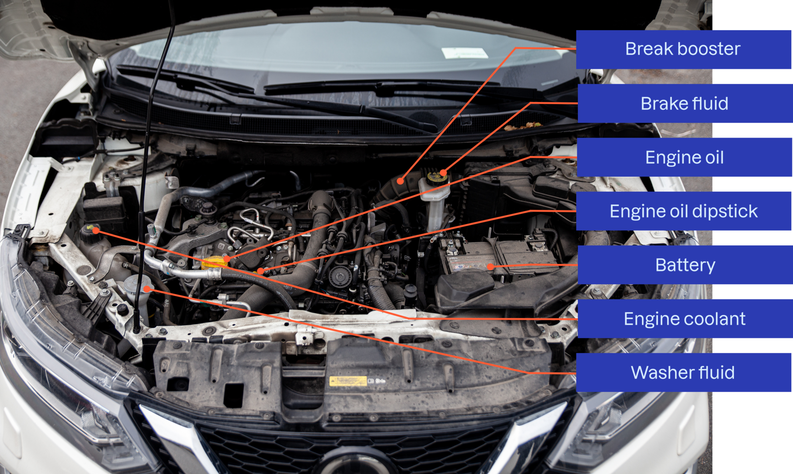
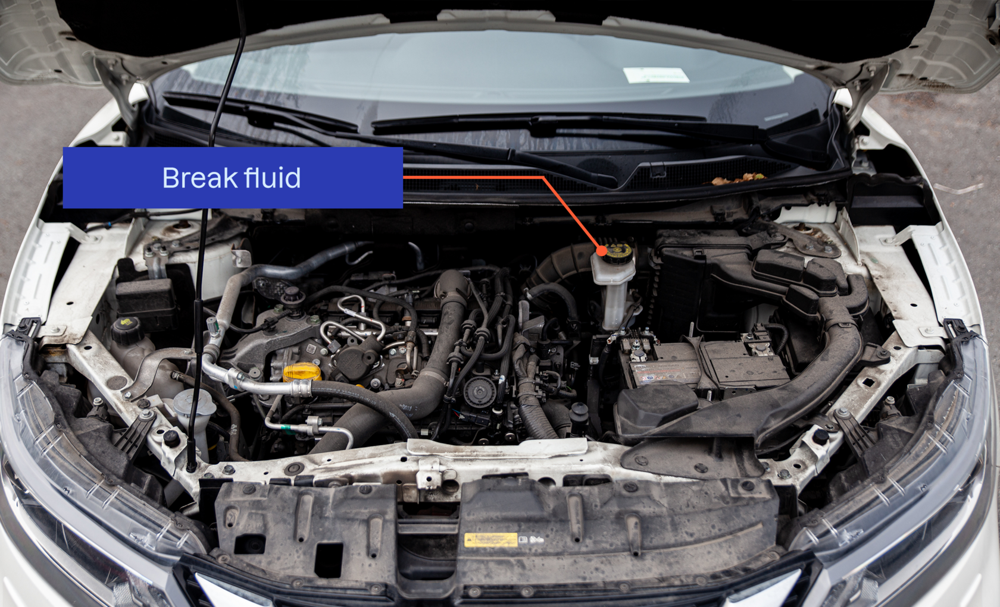

Q: [COMBUSTION CAR ONLY – not your EV] How do you check the brake booster (fossil-fuel cars)?
A: With the engine off, press the brake pedal 5–6 times to empty the booster. Hold the pedal down and start the engine. The pedal should sink, because engine power now assists braking.

---

Q: [COMBUSTION CAR ONLY – not your EV] What does it mean if the brake booster does not work?
A: The car is not legal to drive.

---

Q: [COMBUSTION CAR ONLY – not your EV] Why does a towed car brake poorly?
A: With the engine off there is no brake booster assistance.

---

Q: Where is the brake fluid reservoir and how do you check it?
A: In the engine compartment, in front of the brake pedal. Check the fluid level visually.

---

Q: Should you normally need to top up brake fluid?
A: No. In an emergency, use the fluid type printed on the reservoir lid.

---

Q: What does low brake fluid indicate?
A: The system uses more fluid than normal, likely from worn brake pads or a leak. Take the car to a workshop.

---

Q: How do you check directional stability under braking?
A: On a straight, flat road without traffic, hold the steering wheel lightly and brake gently. The car should keep a straight course.

---

Q: What does it mean if the car swerves to one side when braking?
A: A possible brake fault. If it pulls left, the right-side brakes are most worn, and vice versa. Visit a workshop.

---

Q: What should you do if a brake warning light comes on while driving?
A: Stop and find the cause (two-circuit system failure, low fluid, or technical fault). Visit a workshop.

---

Q: What is a two-circuit braking system?
A: A system required in Norway with two separate brake circuits. If a leak occurs, a backup circuit remains. Both circuits act on both front wheels.

---

Q: Which warning light shows a problem in the two-circuit brake system?
A: The red (!) brake warning light.

---

Q: How do you test the two-circuit brake warning light?
A: Start the engine: the light should come on and go off by itself. Pulling the handbrake up and down should turn the (!) light on and off.

---

Q: How do you check the ABS warning light?
A: The yellow "ABS" lamp should turn off after the engine starts.

---

Q: Is it safe to keep driving if the ABS light comes on while driving?
A: Yes, you can continue driving safely (brakes still work without ABS), but the fault should be corrected.

---

Q: [ELECTRIC CAR] What is regeneration control in electric cars?
A: Adjusting how strongly the car brakes (and recharges) when you lift off the accelerator. Not all EVs allow it; on the school's cars it is adjusted with two levers behind the steering wheel.
