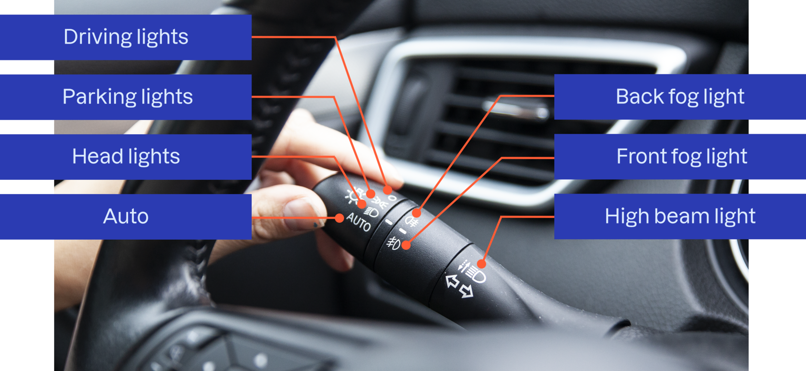

Q: How do you check the brake lights?
A: Look in a mirror while reversing toward a wall, or place the warning triangle cover on the brake pedal and check from behind, or have a helper press the pedal while you look from behind.

---

Q: If the brake lights do not come on, what is the likely cause?
A: A blown fuse or a broken bulb.

---

Q: Is it safe to drive without working brake lights?
A: No. The cause may be a fuse or one or more broken bulbs.

---

Q: How do you check the hazard lights?
A: Press the red triangle button and walk around the car to confirm all hazard lights work.

---

Q: When should hazard lights be used?
A: During an emergency stop (and when the car is a hazard). They should only be used with parking lights, or with no lights on.

---

Q: How do you check the low beam alignment?
A: Shine the low beams at a wall and check that both are aimed correctly. Standing in front of the car you should not be dazzled; if you are, a bulb may be installed incorrectly.

---

Q: What is the drawback of misaligned headlights?
A: They dazzle oncoming drivers and reduce your own visibility in the dark.

---

Q: How do you check the front fog lights?
A: Turn them on and inspect them visually from outside the car.

---

Q: With which lights may front fog lights only be used?
A: Together with parking lights.

---

Q: What is the drawback of misusing front fog lights?
A: They irritate other road users, and you can be fined.

---

Q: How do you check the rear fog lights?
A: Turn them on and inspect them visually from outside the car.

---

Q: What is the drawback of misusing rear fog lights?
A: They can blind other drivers, especially in a queue.

---

Q: How do you check the parking, rear and licence plate lights?
A: They switch on automatically when the engine starts. Walk around the car and check them visually.

---

Q: When should parking lights be used?
A: When parking or stopping in darkness where there are no other nearby light sources.

---

Q: Light stalk: what are the positions/symbols on the light switch?
A: Driving lights, parking lights, head lights, auto, back fog light, front fog light, and high beam light.

---

Q: Where is the hazard light button?
A: In the center of the dashboard, above the center vents (red triangle).

