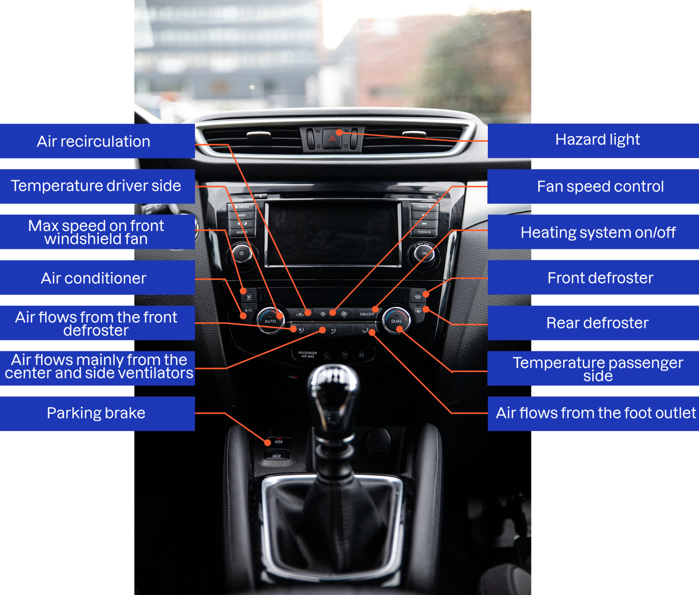

Q: Where is the warning triangle and how do you prepare it?
A: Easy to reach in the luggage compartment. Take it out of its case and mount it.

---

Q: Where do you place the warning triangle in an emergency?
A: Where it is visible to other drivers. In urban areas, consider near crossroads. Outside urban areas, about 150 meters from the vehicle in distress.

---

C: Outside urban areas, place the warning triangle about [150 meters] from the vehicle in distress.

---

Q: What should you do before taking out the warning triangle?
A: Put on the safety vest.

---

Q: Where should the safety vest be located?
A: Reachable from the driver's seat, e.g. door pocket, glove compartment or under the seat.

---

Q: How do you check the battery?
A: Confirm it is firmly attached and the terminals are clean.

---

Q: What is the risk of a loose battery?
A: Leakage and short circuit.

---

Q: How do you check the seat belts?
A: Pull each belt out fully and check for wear, tears and damage, including the locking retractors.

---

Q: What is the risk of a belt with a non-working locking retractor?
A: In sudden braking or a collision the belt will not hold the occupant in position.

---

Q: How do you handle loose objects in the car?
A: Visually check the cabin and store loose items where they cannot cause damage.

---

Q: How do you test the windshield wipers and washer?
A: Turn on the front and rear wipers and test all settings. Wet the glass with washer fluid first, because wiping a dry windshield wears the blades faster.

---

Q: Where is the windscreen washer fluid reservoir?
A: Under the hood; open the hood and identify the container.

---

Q: What do you look for in a visual check of the wiper blades?
A: Damage, deformation, or hardened rubber.

---

Q: How do you use the heater to clear ice and dew?
A: Set the temperature as you like. Do not drive until all dew and frost are removed from the windows. Mirrors and rear windows are often defrosted by a dedicated button.

---

Q: How do you check the sound horn?
A: Press the middle of the steering wheel.

---

Q: How do you check the light horn (flasher)?
A: Pull the left lever (turn signal lever) toward you and release it.

---

Q: Is reckless use of the sound or light horn allowed?
A: No, it is prohibited.

---

Q: How do you check the airbag warning light?
A: Turn on the ignition. The lamp should light up and then turn off automatically after a few seconds.

---

Q: Who should not sit in front of an active airbag, and why?
A: Children and short people, who can be injured if the airbag deploys. Especially a child in a rear-facing seat in the front, who could be squeezed into the seat.

---

Q: How do you check the engine oil level?
A: Open the hood and check that the oil is between the min and max marks on the dipstick.

---

Q: What if the car has no dipstick?
A: Newer cars monitor oil level automatically; low oil triggers a dashboard warning.

---

Q: What should you do if the oil warning lamp is red?
A: Stop the car immediately. Do not drive to a workshop, as it risks engine damage.

---

Q: Do electric cars use engine oil?
A: No.

---

Q: Which button defrosts the front windshield?
A: The front defroster button (air flows from the front defroster). "Max speed on front windshield fan" is a separate button for maximum fan speed on the windshield.

---

Q: Which button defrosts the rear window?
A: The rear defroster button, next to the front defroster button.

---

Q: What does the air recirculation button do, and which button turns the air conditioner on?
A: Recirculation re-uses air from the cabin instead of drawing in outside air. The A/C button controls the air conditioner (it helps dry the air and clear dew).

---

Q: Name the climate-control functions on the dashboard.
A: Air recirculation, temperature (driver and passenger side), max fan speed on front windshield, air conditioner, fan speed control, heating system on/off, front and rear defroster, and air-flow selection (front defroster, center/side ventilators, foot outlet).

---

Q: Where is the parking brake button on the example car?
A: On the center console, next to the gear lever (electric parking brake).

