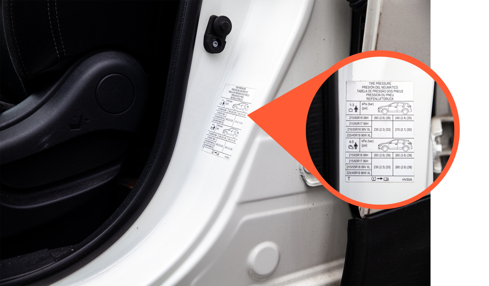

Q: What do you look for when checking tires for damage?
A: Uneven wear, bulges, cracks, and embedded objects that could cause air leaks (in tires and rims).

---

Q: What is common tire damage, and why is it dangerous?
A: Side tears/wounds on the tire and bulges on the rim edge. They reduce the tire's resilience and can cause a blowout while driving.

---

Q: How do you check that the tires have the correct dimension?
A: Compare the size printed on the tire with the "Aksler / dekk / felger" column in the registration certificate. Alternative sizes listed there are also accepted.

---

Q: By how much may the rolling circumference deviate when fitting a different tire size?
A: Up to ±5%.

---

Q: What does a larger rim require?
A: A lower-profile tire, so the rolling circumference stays the same.

---

Q: Where do you find the correct tire pressure?
A: On the label in the door jamb, inside the fuel tank lid, or in the owner's manual.

---

Q: Example car: what tire pressure for 1–3 passengers plus luggage?
A: 260 kPa front, 240 kPa rear.

---

Q: Example car: what tire pressure for 4–5 passengers plus luggage?
A: 260 kPa front and 260 kPa rear.

---

Q: How do you check and adjust the tire pressure?
A: Use a pressure gauge (available at gas stations): remove the valve cap, read the pressure, and add air in small amounts until it matches the specification.

---

Q: What does the dashboard tire pressure warning lamp indicate?
A: Incorrect tire pressure (the school's training cars have this lamp).

---

Q: What is the minimum tread depth for winter tires, and when does it apply?
A: 3 mm, from November 1 until the second Sunday after Easter Monday.

---

Q: What is the minimum tread depth for summer tires?
A: 1.6 mm.

---

C: Minimum tread depth is [3 mm] for winter tires (1 Nov to 2nd Sunday after Easter Monday) and [1.6 mm] for summer tires.

---

Q: Where do you measure tread depth?
A: At the most worn point of the tire.

---

Q: How do you measure tread depth?
A: With a tread depth gauge, in three places (e.g. both edges and the center), also checking for bumps on the surface.

---

Q: What are the risks of low tread depth?
A: Reduced grip, higher risk of aquaplaning, longer braking distance, and possible insurance recourse or loss of coverage.

---

Q: How do you check the wear of the front tires?
A: Look at the tread wear indicators and check for center wear or edge wear.

---

Q: What does center wear on a tire indicate?
A: Over-inflation (too high pressure).

---

Q: What does edge wear on a tire indicate?
A: Under-inflation (too low pressure).

---

Q: What can uneven tire wear indicate?
A: Worn shock absorbers.

---

Q: What does "Min.LI" in the registration certificate tell you?
A: The minimum load index the tires must have. Example: 84 corresponds to 500 kg per tire.

---

Q: Example: the certificate lists load index 84. What load does that correspond to?
A: 500 kg.

---

Q: How do you check the speed code of the tires?
A: Compare the speed code on the tire with the one in the registration certificate. Any code later in the alphabet than the certificate's code is acceptable.

---

Q: Certificate says speed code U (min. 200 km/h), tire says V (240 km/h). Is the tire acceptable?
A: Yes. V comes later in the alphabet than U, so it is acceptable.

---

Q: Example: certificate lists 215/65R16, tire reads 215/55R18. Is that acceptable?
A: Yes, if the certificate lists it as an alternative size. A larger rim (18") needs a lower-profile tire (55).

