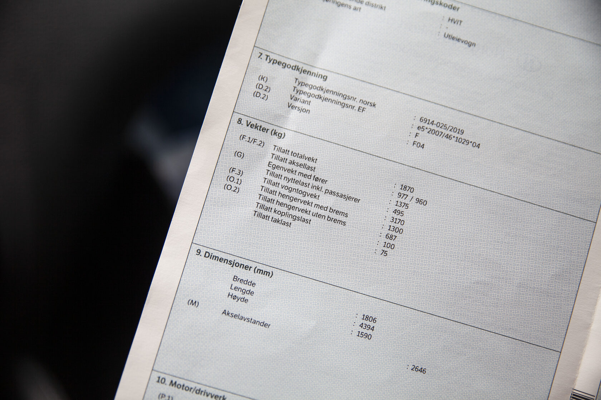

Q: Where do you find the maximum towable trailer mass for your car?
A: In the vehicle registration certificate (vognkort), in the "Weights" section.

---

Q: Example registration certificate: what is the maximum braked trailer weight, and the maximum unbraked trailer weight?

A: Braked: 1300 kg. Unbraked: 687 kg.

---

C: In the example certificate, the permitted trailer weight is [1300 kg] with brakes and [687 kg] without brakes.

---

Q: Example registration certificate: what is the permitted roof load?

A: 75 kg.

---

Q: Example registration certificate: what is the permissible coupling (towball) load?

A: 100 kg.

---

Q: Example registration certificate: what is the allowed total weight of the car?

A: 1870 kg.

---

Q: Example registration certificate: what is the permitted payload including passengers?

A: 495 kg.

---

Q: Example registration certificate: what is the net weight with driver?

A: 1375 kg.

---

Q: Example registration certificate: what are the permissible axle loads?

A: 977 kg (front) / 960 kg (rear).

---

Q: Example registration certificate: what is the permitted weight of the car and trailer combined?

A: 3170 kg.

---

Q: What are the consequences of exceeding the weight limits (overloading)?
A: Reduced wheel traction, weaker directional stability, longer total stopping distance, and raised headlights that can dazzle other drivers.

---

Q: What is the drawback of overloading the rear of the vehicle?
A: Worse drivability, longer stopping distance, and the raised headlights can dazzle other drivers.

---

Q: What is the maximum trailer you can tow with a category B licence?
A: A trailer up to 750 kg total weight. A heavier trailer is allowed if car plus trailer together do not exceed 3500 kg. You can never tow more than the registration certificate permits.

---

C: With category B you may tow a trailer up to [750 kg] total weight, or heavier if car + trailer do not exceed [3500 kg].

---

Q: What are the consequences of towing a trailer that is too heavy?
A: It is illegal and dangerous: traction decreases, handling becomes uneven, braking distance increases, and the front may lift and dazzle other drivers.
